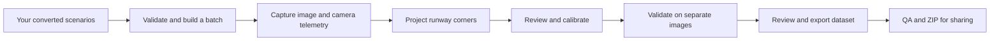
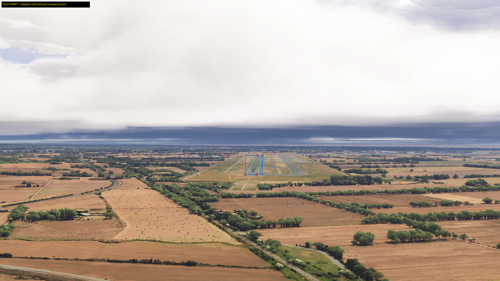

# MSFS 2024 Runway Auto-Labelling and Dataset Creation

Tools for capturing runway-approach images in Microsoft Flight Simulator 2024 and creating four-corner runway labels from camera telemetry.

**Author:** Taylan Miroğlu · TU Clausthal · University research project · [MIT code licence](LICENSE)

This repository contains the simulation and annotation work: scenario execution, a native Camera API bridge, automatic projection, calibration, review applications, quality checks, synthetic rain, and enhanced runway lights. The input is a ready-to-use scenario. The output is a dataset with images, labels, and records explaining how each label was created.

## Workflow



Optional experiments add synthetic Heavy Rain or an additive runway-light package. They should be recorded as separate dataset variants.



The green polygon is an automatically projected **candidate**, shown for inspection. The label target is the usable runway pavement. Lights help locate it, but their glow is not the runway boundary.

## Contents

| Folder | What it contains |
|---|---|
| `tools/` | Capture, projection, review, calibration, QA, and packaging scripts |
| `camera_bridge/` | Native C++ bridge source and Windows build script |
| `enhanced_lights/` | Current five-airport light generator and package build tools |
| `examples/scenarios/` | Five already-converted scenario examples, one per airport |
| `examples/scenarios.json` | A flat five-record batch that capture can read directly |
| `examples/sample_capture/` | Five saved images and matching camera telemetry for an offline trial |
| `examples/sample_labels/` | Candidate labels for those saved images |
| `examples/profiles/` | Paired historical five-airport geometry and pixel-calibration examples |
| `docs/` | Input format, calibration, datasets, weather, and lighting guides |
| `tests/` | Offline tests; they do not start MSFS |

## 1. Requirements

For live capture:

- Windows 10/11, 64 bit.
- Microsoft Flight Simulator 2024.
- MSFS 2024 SDK with the Camera API declarations used by the bridge.
- Visual Studio 2022 Build Tools, with **Desktop development with C++**, MSVC v143, and a Windows SDK.
- Python 3.10 or newer, 64 bit. Tested with Python 3.12.
- Python Tkinter, normally included with the Windows Python installer, for desktop review.

The Camera API was beta during development. A different simulator or SDK version may require updates. The five-airport calibration is an example profile; it must be checked against your camera and scenery.

You can use the saved-image example, review applications, and most QA tools without running MSFS. Live capture and the native bridge require Windows/MSFS.

## 2. Install Python dependencies

Open PowerShell in this repository folder:

```powershell
python -m venv .venv
.\.venv\Scripts\Activate.ps1
python -m pip install -r requirements.txt
```

If activation is blocked, run commands with `.\.venv\Scripts\python.exe` directly.

For offline tests:

```powershell
python -m pip install -r requirements-dev.txt
python -m pytest -q
```

## 3. Try the saved example first — no simulator needed

Check the input and saved capture:

```powershell
python tools/validate_scenarios.py examples/scenarios.json
python tools/validate_dataset.py --dataset-dir examples/sample_capture
```

Generate labels using the paired example profiles:

```powershell
python tools/label_camera_api_capture.py --dataset-dir examples/sample_capture --output-dir work/example_labels --runway-geometry examples/profiles/five_airport_geometry.json --pixel-calibration examples/profiles/five_airport_pixel_calibration.json --overlay
```

Open `work/example_labels/label_preview/` and compare the polygons to the pavement. These are draft candidates, not automatically approved ground truth.

Prepare the five candidates for desktop review:

```powershell
python tools/prepare_label_review.py --dataset-dir examples/sample_capture --labels-dir work/example_labels --output-dir work/example_review --count 5
python tools/review_training_labels.py --package-dir work/example_review --output work/example_review/qa/review.json --annotator "Your name"
```

In the review app:

- Press **F** to inspect the full image before accepting.
- Press **1–4** to select a corner, then click to move it.
- Use the wheel to zoom and middle-drag to pan.
- Press **A** to accept, **X** to exclude with a reason, or **S** to skip for now.
- Decisions save automatically. Re-run the same command to resume.
- Export requires a final decision for every image in the review package.

Export your completed example review:

```powershell
python tools/export_training_ground_truth.py --package-dir work/example_review --review work/example_review/qa/review.json --output-dir work/example_release
python tools/validate_dataset.py --dataset-dir work/example_release --output work/example_release/qa/integrity.json
```

Use a new output folder each time. Existing captures, draft folders, and releases are not overwritten by these commands.

## 4. Prepare your scenarios

Scenario generation and conversion are outside this repository's workflow. Provide your own converted records in the format shown in `examples/scenarios/`, or provide a flat batch like `examples/scenarios.json`.

See [the scenario-format guide](docs/scenario-format.md) for required fields, units, corner order, and coordinate conventions.

Validate a folder of converted scenarios:

```powershell
python tools/validate_scenarios.py path/to/your/scenarios
```

Build a batch for one weather condition:

```powershell
python tools/build_batch.py --src path/to/your/scenarios --output work/broken_clouds_batch.json --weather "Broken Clouds" --min-dist 300 --max-dist 5500 --count 100
```

Omit `--count` to include every matching scenario. Use `--icao EDDM EDDS` or `--hour 12` to filter airports or UTC hours. Batch selection spans distance and balances available airport/time groups.

For the five supplied examples:

```powershell
python tools/build_batch.py --src examples/scenarios --output work/example_batch.json --weather "Broken Clouds" --count 5
```

The flat batch and the converted-scenario examples are separate examples; they do not need to contain identical scenario IDs.

## 5. Build the Camera API bridge

Install the MSFS 2024 SDK through the simulator's Developer Mode SDK installer. Then build the bridge with your SDK directory:

```powershell
powershell -NoProfile -ExecutionPolicy Bypass -File camera_bridge/build.ps1 -SdkRoot "C:\MSFS 2024 SDK"
```

The build creates `camera_bridge/bin/Release/camera_bridge.exe`.

Python runs this helper automatically during capture. You do not need to keep a second helper terminal open. It acquires an add-on camera and returns camera pose, field of view, status, and Facilities API data.

## 6. Set up MSFS

1. Start a free flight and load the aircraft. The project used the Cessna Citation CJ4.
2. Select your weather preset manually. Start with **Broken Clouds** for the supplied example batch.
3. Disable Live Weather, multiplayer, AI assistance, warnings, menus, and HUD overlays that could appear in screenshots.
4. Keep slew mode off. The capture script freezes and holds the aircraft itself.
5. Run MSFS full-screen or borderless on the **primary monitor**. The screen grab captures that entire monitor, so the image must contain the simulator viewport only.
6. Use a 16:9 viewport and output for the supplied profiles. The project captured a 3840×2160 primary display and downsampled to 1920×1080.
7. Hide developer windows before capture and allow scenery to finish loading.

The Camera API sets the dedicated camera, including FOV and offset. Manual cockpit zoom is not part of this workflow. The camera points at the intended capture direction while scenery settles.

## 7. Capture a small pilot

With MSFS running and the selected weather active:

```powershell
python tools/capture_scenarios_camera_api.py --batch examples/scenarios.json --output-dir runs/pilot_01 --order airport-time-distance --width 1920 --height 1080 --format png --settle 3 --airport-settle 60 --time-settle 5 --start-delay 10 --fov 28.555 --camera-pitch 0 --camera-z 16
```

Switch to MSFS during the start delay and keep it in front until the run finishes.

The command changes airports, poses, and times automatically. One capture run should use one manually selected weather condition. A short pilot must be checked before an unattended large batch.

Important settings:

| Setting | Meaning |
|---|---|
| `--settle 3` | Per-scenario scenery wait |
| `--airport-settle 60` | Extra wait after an airport change, including the initial airport |
| `--time-settle 5` | Extra wait for a time change within an airport |
| `--fov 28.555` | Vertical FOV in degrees |
| `--camera-z 16` | Camera API eyepoint-relative offset used to clear the aircraft |
| `--end 10` | Capture the first ten records after ordering; end is exclusive |
| `--start 10` | Start at ordered record index ten; indexes are zero-based |
| `--weather-quality-action flag` | Save weather mismatches with flags rather than aborting for those mismatches |

Camera-control or capture-integrity failures can still stop a run. Weather flags should be reviewed before release. Settling times are minimum waits; loading, camera handling, screenshots, and encoding add time.

Capture output:

```text
runs/pilot_01/
├── images/
├── telemetry/
├── captured_batch.json
├── capture_run.json
├── manifest.csv
└── runway_facilities.json
```

Check the captured files:

```powershell
python tools/validate_dataset.py --dataset-dir runs/pilot_01 --output work/pilot_capture_qa.json
```

## 8. Generate candidate runway labels

For your own scenery, begin with the captured Facilities API geometry:

```powershell
python tools/label_camera_api_capture.py --dataset-dir runs/pilot_01 --output-dir work/pilot_labels --overlay
```

The script automatically reads `runway_facilities.json` from the capture. You can provide another snapshot with `--facility-data`.

For the historical five runways, you can test the supplied paired profiles:

```powershell
python tools/label_camera_api_capture.py --dataset-dir runs/pilot_01 --output-dir work/pilot_labels_profile --runway-geometry examples/profiles/five_airport_geometry.json --pixel-calibration examples/profiles/five_airport_pixel_calibration.json --overlay
```

The label report distinguishes candidates and exclusions. The default minimum box dimension is 25 pixels; it can be changed with `--min-box-px`.

Draft labels are saved as:

- `labels/`: YOLO detection boxes.
- `labels_seg/`: YOLO segmentation polygons.
- `labels_pose/`: YOLO boxes and four ordered keypoints.
- `labels_px/`: exact pixel corners.
- `label_preview/`: optional overlay images.
- `label_report.json`: status, geometry sources, hashes, and exclusions.

## 9. Review and calibrate

Prepare a package of candidates and review it:

```powershell
python tools/prepare_label_review.py --dataset-dir runs/pilot_01 --labels-dir work/pilot_labels --output-dir work/pilot_review --count 5
python tools/review_training_labels.py --package-dir work/pilot_review --output work/pilot_review/qa/review.json --annotator "Your name"
```

Set `--count` to the number of candidates you want to review; it cannot exceed the available candidates. A five-image pilot checks the setup but is too small to fit the full residual calibration.

Use the same boundary rule in day and night images: near-right, near-left, far-left, far-right, viewed along the landing direction. Exclude shoulders, blast pads, taxiways, and pavement before a displaced landing threshold. Do not use light centres or glow as pavement corners.

If systematic errors remain, follow [Calibration and independent validation](docs/calibration.md). It explains:

1. Collecting reviewed near/middle/far examples.
2. Fitting the rendered runway geometry.
3. Fitting a small per-airport pixel correction.
4. Checking on disjoint, independently measured images.
5. Rejecting a new fit if it performs worse.

For precise corner measurements, the separate **Runway Reference Corners** app is also included. The calibration fits consume the final-review app's hash-bound review records; the reference-measurement file is not interchangeable with that review format.

## 10. Capture and release your full dataset

After pilot and calibration checks, run capture on your full single-weather batch. Create a separate run for each weather preset. Label it using the checked geometry/calibration and review the candidate images.

The basic release route in this repository exports **individually reviewed images**:

```powershell
python tools/export_training_ground_truth.py --package-dir work/pilot_review --review work/pilot_review/qa/review.json --output-dir outputs/reviewed_dataset
python tools/validate_dataset.py --dataset-dir outputs/reviewed_dataset --output outputs/reviewed_dataset/qa/integrity.json
python tools/package_dataset.py --dataset-dir outputs/reviewed_dataset --output outputs/reviewed_dataset.zip
```

The ZIP has a separate `.zip.sha256` checksum. You can upload these files to Google Drive or another dataset host and link them from GitHub.

The final release includes pixel JSON, JSON Lines, COCO polygons/boxes/keypoints, and the three YOLO formats. Review decisions and exclusion reasons are retained. It does not create a train/validation/test split. Keep related viewpoints and repeated rendering variants together when splitting.

The research datasets contain both reviewed labels and validated automatic projections. Their annotation sources and quality results are described in the [data card](docs/datasets.md).

## Optional: synthetic Heavy Rain

See [Synthetic rain](docs/synthetic-rain.md). The image-only tool adds deterministic multi-scale streaks. The capture-aware wrapper also carries camera metadata forward and records the original and augmented hashes.

```powershell
python tools/augment_capture.py --source-dir runs/pilot_01 --output-dir runs/pilot_01_synthetic_rain --preset heavy --seed 20260903 --angle 10
```

Generate fresh labels for the derivative capture, then review and export it. The transformation changes appearance without moving the runway geometry. It is not a physically validated model of rainfall.

## Optional: enhanced runway lights

See [Enhanced runway lights](docs/enhanced-lights.md). The current generator supports EDDM 26R, EDDS 25, LFQQ 26, LIRF 16L, and LSZH 14. It creates additive light rows using Facilities API metadata and optional fitted runway geometry.

The guide explains querying facilities, generating XML, preparing short-path per-airport packages, building with MSFS closed, installation, pilot rating, and separate recapture. The source profile uses `boostDayLight=false` and was evaluated at distances of at least 2 km.

## Download the research datasets

The full datasets are hosted separately because the images are large. GitHub contains tools, small examples, and documentation.

| Release | Stored images | Training-ready | Excluded |
|---|---:|---:|---:|
| Original `MSFS_Runway_Dataset_6480_v1` | 6,480 | 6,201 | 279 |
| Enhanced lights `MSFS_Runway_Dataset_EnhancedLights_2474_v2` | 2,474 | 2,247 | 227 |

See [Dataset downloads and data card](docs/datasets.md) for downloads, label formats, weather counts, annotation sources, and limitations.

## Troubleshooting

- **Bridge missing:** build `camera_bridge/build.ps1`; use `--helper` if the executable is elsewhere.
- **Wrong or cropped view:** check primary-monitor full-screen coverage, aspect ratio, aircraft, and camera clearance.
- **Geometry error:** inspect the Facilities snapshot and camera FOV convention, then collect calibration references.
- **Wrong labels after changing scenery/camera:** recalibrate and independently validate.
- **Output already exists:** choose a new directory. Do not mix captures into an earlier run.
- **A runway is invisible:** exclude it under the review policy; a projected polygon alone does not make a useful visible-positive example.
- **Rain stopped after teleport:** inspect per-frame weather telemetry and reapply the preset. The workflow does not automate weather selection.
- **Lights merge into a white line:** inspect radius, intensity, airport scaling, and daylight boost using a pilot.
- **Scenery build waits on the running simulator:** close MSFS and build the separate short-path airport projects.

## Credits and licence

Taylan Miroğlu developed the simulation capture, Camera API integration, annotation, calibration/review tools, weather augmentation, and lighting work presented here. Prof. Umut Durak and Siddhartha Gupta provided project direction and supervision. The example scenarios are adapted from the project scenario collection provided by Siddhartha Gupta. See [examples](examples/README.md) for their format and source.

Microsoft Flight Simulator and its SDK are Microsoft products. Install the SDK separately; Microsoft SDK headers, libraries, and runtimes are not distributed here.

The software and documentation are available under the [MIT licence](LICENSE). See [NOTICE.md](NOTICE.md) for attribution and the scope of the licence.
